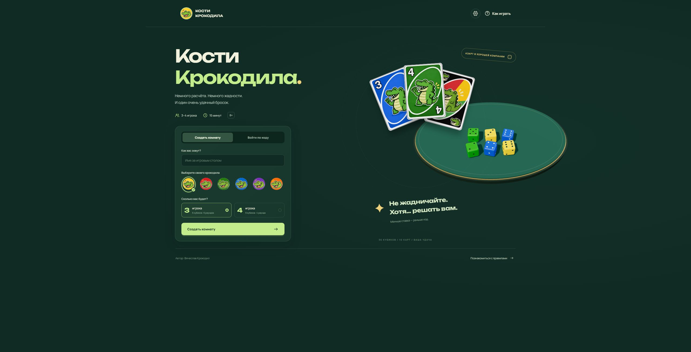
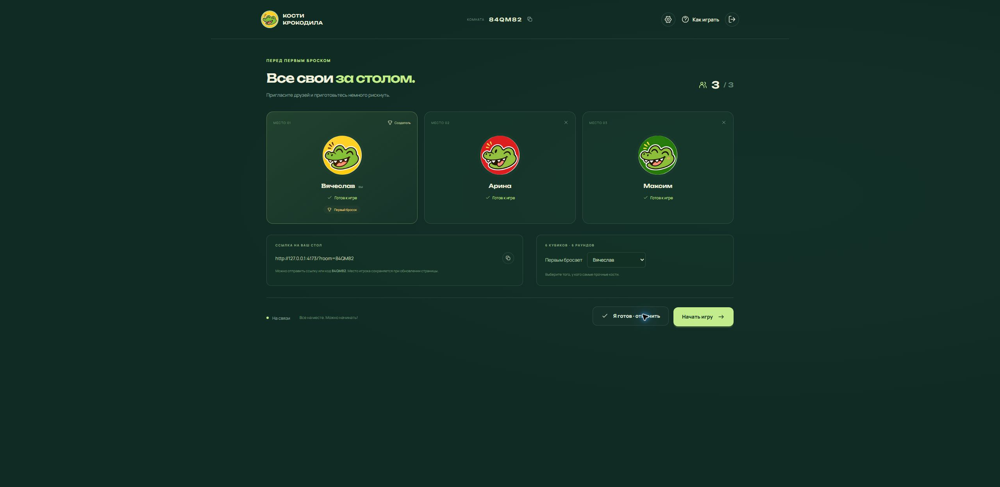
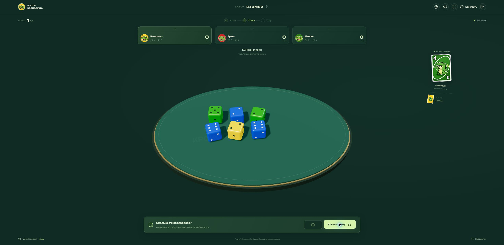

# Кости Крокодила

**3–4 игрока · около 15 минут · 8+**

«Кости Крокодила» — браузерная игра с кубиками, тайными ставками и картами, которые удваивают очки. Здесь приходится выбирать между осторожным расчётом и желанием забрать побольше: чем меньше ваша ставка, тем раньше вы ходите, но тем меньше очков сможете получить.

Создайте комнату, пригласите друзей по ссылке или коду и выберите своего крокодила. За игровым столом вас ждут объёмные кубики, коллекции игроков, история партии и итоговый подсчёт очков. На телефоне удобнее играть в горизонтальном положении.

## Скриншоты

**Главное меню — выбор персонажа и комнаты**

**Комната — друзья собираются перед первым броском**

**Игровой стол — кубики, активная карта и тайные ставки**

## Цель игры

Набрать больше всех очков на собранных кубиках. Каждый свободный кубик приносит столько очков, сколько на нём выпало. Кубики, закреплённые на картах, приносят вдвое больше.

## Перед началом

1. Один игрок создаёт комнату на троих или четверых и отправляет друзьям приглашение или код.
2. Каждый участник вводит имя, выбирает персонажа и нажимает «Я готов».
3. Создатель выбирает первого игрока и начинает партию.

В игре 36 кубиков: по 12 голубых, жёлтых и зелёных. В колоде 10 карт: по одной карте на 2, 3 и 4 кубика каждого цвета, а также одна четырёхцветная карта.

| Участники | Новых кубиков в каждом раунде | Раунды за партию |
| --- | --- | --- |
| 3 игрока | 6 | 6 |
| 4 игрока | 9 | 4 |

## Ход раунда

1. **Бросок.** Первый игрок бросает новую порцию случайных кубиков из банка вместе с теми, что остались на столе с прошлого раунда.
2. **Тайные ставки.** Каждый указывает целое неотрицательное число — сумму значений кубиков, которую хочет забрать. Ставки раскрываются только после ответа всех участников.
3. **Очередь.** Первым ходит игрок с наименьшей ставкой, затем остальные по возрастанию. При равных ставках приоритет идёт по часовой стрелке от первого игрока раунда.
4. **Сбор кубиков.** В свой ход выберите один или несколько оставшихся кубиков, сумма которых **точно равна вашей ставке**. Можно сочетать разные цвета. Например, на ставку 8 подойдут кубики со значениями 6 и 2 или 5 и 3.
5. **Пропуск.** Если нужную сумму собрать уже нельзя, ход пропускается. Нулевая ставка тоже означает пропуск: забрать нужно хотя бы один кубик.
6. **Следующий раунд.** Неразобранные кубики остаются для следующего броска, а право первого хода переходит по часовой стрелке.

## Карты и удвоение очков

В каждый момент доступна одна активная карта. Цветная карта требует указанное на ней количество свободных кубиков соответствующего цвета: 2, 3 или 4. Значения на этих кубиках могут быть любыми.

**Четырёхцветная карта требует по 2 кубика каждого цвета — всего 6 кубиков.**

Если у игрока есть подходящий набор, карту обязательно нужно получить. Когда возможен только один набор, игра закрепляет его автоматически; если вариантов несколько, игрок сам выбирает кубики.

Полученная карта и кубики на ней остаются у игрока до конца партии. Закреплённые кубики нельзя заменить или использовать для другой карты. Их значения при подсчёте очков удваиваются.

После получения карты сразу открывается следующая. Если она подходит кому-то из участников, этот игрок получает её даже вне своего хода. При нескольких претендентах приоритет идёт по часовой стрелке от первого игрока раунда. Такая цепочка продолжается, пока есть подходящие наборы.

## Конец партии и победа

После последнего раунда игра подсчитывает результат:

- свободные кубики — сумма их значений;
- кубики на картах — сумма их значений, умноженная на 2.

Например, свободные кубики на 12 очков и кубики на картах на 9 дают **12 + 9 × 2 = 30 очков**.

Побеждает игрок с наибольшим результатом. При равенстве максимальных очков победа общая. После итогов создатель комнаты может начать новую партию с той же компанией.

## Автор

**Вячеслав Крокодил**

- Телеграм: [@vcroc](https://t.me/vcroc)
- ВК: [@vcroc](https://vk.com/vcroc)
- Почта: [vsv.crocodile@gmail.com](mailto:vsv.crocodile@gmail.com)
